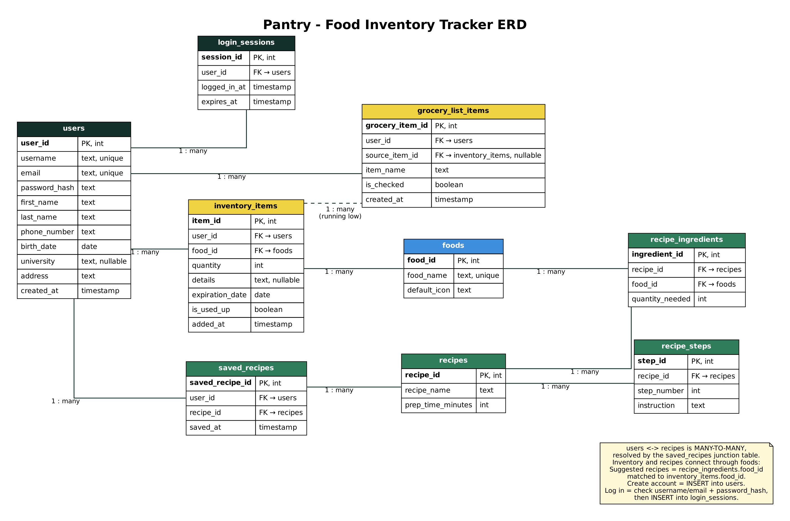
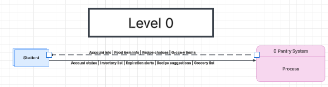
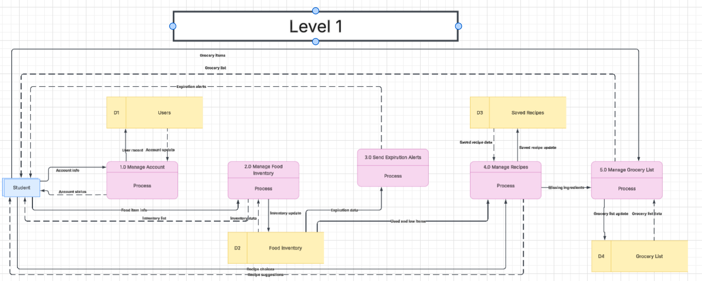

# Section 1 Group 1 README Document
 
## 1. App Summary
 
College students with access to a kitchen, groceries, and cooking for themselves need a single website platform that can account for their purchased food as they grocery shop and help them use their food in a timely manner by suggesting recipes based on what they already have. Whether living alone or with roommates, students often buy and manage their own food individually, making it difficult to buy the right amount, avoid over-buying, and use ingredients before they expire. Tracking expiration dates and finding efficient ways to use food before it goes bad, while also remaining budget-conscious with limited free time for meal planning, can be difficult. We see this platform aiding individual students in eliminating food waste, building more conscious grocery habits, and managing expiration dates efficiently. As a future direction, we see this platform growing to let roommates compare or share grocery inventory. This website lets students log groceries as they shop by entering items, tracks each item's expiration date, and sends reminders before food goes bad. It then suggests recipes built from the ingredients they already have.
 
## 2. ERD
 

 
## 3. Data Flow Diagrams
 
### Level 0 – Context Diagram
 
The whole Pantry app is shown as one process. The Student sends account info, food item info, recipe choices, and grocery items into the system. The system sends back account status, the inventory list, expiration alerts, recipe suggestions, and the grocery list.
 

 
### Logical Level 1
 
The Pantry System is broken into five processes:
 
| Process | What it does | Data stores |
|---|---|---|
| 1.0 Manage Account | Creates accounts, logs users in, and updates profiles | D1 Users |
| 2.0 Manage Food Inventory | Adds, edits, deletes, and marks food items as used | D2 Food Inventory |
| 3.0 Send Expiration Alerts | Checks expiration dates and alerts the student | D2 Food Inventory |
| 4.0 Manage Recipes | Suggests recipes from current food and saves recipes | D2 Food Inventory, D3 Saved Recipes |
| 5.0 Manage Grocery List | Builds the grocery list from entries, missing ingredients, and used or low items | D2 Food Inventory, D4 Grocery List |
 

 
**Do the diagrams match?** Yes. Level 1 has the same external entity (Student) and the same nine outside data flows as Level 0. Every data flow is labeled, all data passes through a process (no flows straight between the Student and a data store), and no technology names are used.
 
## 4. Tech Stack
 
As a team, we decided to use a backend as a service, specifically Supabase. This fits our team because we felt the most comfortable being able to maintain some of the control in building at least part of our website.
 
## 5. How to Get it Running
 
Pantry is a static website (HTML, CSS, and JavaScript) that talks to a hosted Supabase database. There is nothing to install and no server to start: the database is already running in the cloud, and the page connects to it when it loads.
 
**To Open the App (live):**
 
1. Go to https://lukepchristensen13.github.io/Claude-Digital-Mockup/
2. The app loads in your browser and connects to our Supabase database automatically.
**To Run it From a Fresh Copy of Code:**
 
1. Clone the repository:
```
   git clone https://github.com/lukepchristensen13/Claude-Digital-Mockup.git
   cd Claude-Digital-Mockup
```
2. Start a simple local web server from that folder:
```
   python3 -m http.server 8000
```
3. Open http://localhost:8000 in your browser.
4. The page connects to the same Supabase database as the live app, so you will see the same data.
**For the Database:**
 
- The database is hosted on Supabase, so there is no local database to set up.
- The tables match the ERD above, and each has a few rows of sample data already loaded.
- The secret service_role key and the database password are not in this repository.
## 6. Working Action
 
Our working action is adding a food item, which saves it to the user's inventory.
 
1. Open the app and go to the **Food Inventory** screen.
2. Click the yellow **+** button and fill in the item details: **name, unit type, unit measurement (if not Individual), quantity, expiration date (or check "No expiration date"), and optional details**. For example, enter "Milk", unit type gallon, measurement 1, quantity 1, and a date next week.
3. Click **Save**.
4. Confirm the change appears in the UI: the new item shows up in the inventory list without reloading the page.
5. Refresh the page (Ctrl+R on Windows, Cmd+R on Mac).
6. Confirm the item is still in the list.
Note that:
 
- Clicking **Save** sends a request to Supabase, which inserts a new row into the `inventory_items` table.
- Supabase returns the saved row, and the page displays it.
- Because the item is stored in the database and not just on the page, it is still there after a refresh.
- To double-check in the database, open the Supabase dashboard, go to **Table Editor**, select `inventory_items`, and look for the new row.

Note that:
-clicking Add Item sends a request to Supabase, which inserts a new row into the inventory_items table.
-Supabase returns the saved row, and the page displays it.
-Because the item is stored in the database and not just on the page, it is still there after a refresh.
-To double-check in the database, open the Supabase dashboard, go to Table Editor, select inventory_items, and look for the new row.
